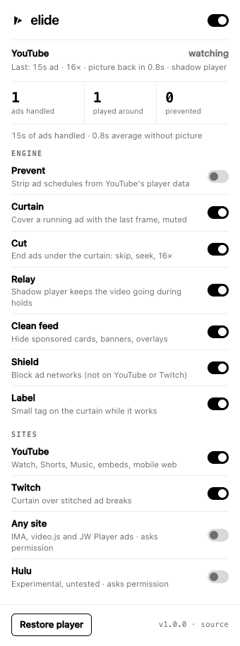
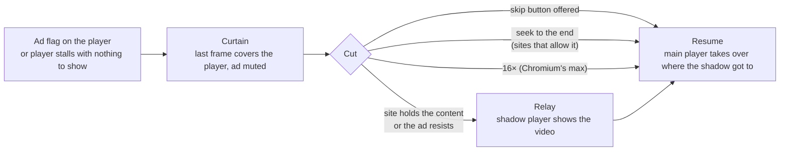

<picture>
  <source media="(prefers-color-scheme: dark)" srcset="assets/banner-dark.png">
  
</picture>

**Elide** is a browser extension that takes ads out of video and keeps the picture going. You don't see the ad, you don't hear it, and on YouTube a second, ad-free copy of the video keeps playing while YouTube makes the main player wait.

It's the successor to AdRush 2.0, rebuilt from scratch after testing what actually works against the real sites in October 2026. Every claim below comes from a test in this repo that you can run yourself.

[Install](#install) · [How it works](#how-it-works) · [Measured](#measured) · [Platforms](#platforms) · [Limits](#what-elide-cannot-do) · [Privacy](#permissions-and-privacy) · [Develop](#develop)

<p align="center">
  <picture>
    <source media="(prefers-color-scheme: dark)" srcset="assets/popup-dark.png">
    
  </picture>
</p>

---

## Install

Elide isn't on the Chrome Web Store. You load it yourself in developer mode (takes a minute):

1. Download `elide-x.y.z.zip` from the [latest release](https://github.com/VictorDeglon/elide/releases/latest) and unzip it.
2. Open `chrome://extensions`, then turn on **Developer mode** (top right).
3. Click **Load unpacked** and select the unzipped `elide-x.y.z` folder (the one containing `manifest.json`).
4. Pin Elide from the puzzle-piece menu to reach its settings.

This works in Chrome, Edge, Brave, Arc, Opera, Vivaldi and other Chromium browsers, version 111 or later. Firefox isn't supported yet. To update, download the new release and click the reload arrow on Elide's card in `chrome://extensions`, or point it at the new folder.

## How it works

Every interruption goes through the same pipeline. Each step is a switch in the popup:



**Detect.** Each site has an adapter that knows its player. YouTube marks ads with an `ad-showing` class on `#movie_player`. Twitch shows an ad label and countdown. IMA ads play in a `<video title="Advertisement">`. A player that wants to play but has nothing to show for 2.5 seconds counts as a stall.

**Curtain.** While content plays, Elide copies the current frame to a canvas every 0.4 s (one `drawImage`). When an ad starts, that frame goes over the player in the same task the flag appears, and the ad is muted. Before the first frame of a video it uses the thumbnail. The curtain sits inside the player, so it follows fullscreen and theater mode, and it swallows clicks so you can't hit the ad by accident. Double-click it to see the ad anyway.

**Cut.** Under the curtain, Elide ends the ad as fast as the site allows:

1. **The site's own skip button**, once it's offered.
2. **Seek to the end.** Setting `currentTime = duration` ended a 15-second ad in 0.23 s in testing, about 66×. This works on players that load ads as plain files (IMA, video.js, JW Player). Elide never seeks anything that looks like the video itself (same source, or same length as the video), so a stitched ad can't fling you to the end of the film.
3. **16×.** Chromium won't go faster: `playbackRate = 17` throws `NotSupportedError`. AdRush's "20×" setting silently fell back to 16. Elide uses 16× for ads stitched into the stream and for players that refuse the seek. If a player keeps resetting the rate, Elide stops after 4 resets a second rather than looping, and hands the ad to the relay.

**Relay (the shadow player).** On YouTube, cutting the ad doesn't bring the video back sooner (see [the next section](#what-youtube-does-today)). So Elide keeps a second copy of the video ready: YouTube's own embed player, loaded muted and paused, invisible behind the main player.

- When it warms up: the moment a video opens, and about 20 s before each scheduled mid-roll. YouTube publishes those times in its player data, and Elide reads them.
- When it takes over: as soon as an ad starts or the main player stalls. It plays the video from where you were, with your volume and speed, while the main player sits out the ad muted underneath.
- When it hands back: once YouTube releases the main player, Elide moves it to wherever the shadow had got to, and lifts the curtain on the first frame. Your volume, mute state and playback speed are restored.

**Prevent (off by default).** An optional script strips ad schedules (`adPlacements`, `adSlots`, `playerAds`) out of YouTube's player data before the player reads it. It covers the inline `ytInitialPlayerResponse`, `fetch` responses, and `JSON.parse`. Today YouTube answers that with a startup hold on most videos (measured below), so it's off by default.

**Clean feed** hides sponsored cards, masthead and companion ads, product shelves, banner overlays on the player, and "Try Premium" popups. **Shield** blocks a short list of ad-network hosts at the network layer, everywhere except YouTube and Twitch (blocking their ad pings there invites anti-adblock checks).

### What YouTube does today

These findings shaped the design. They come from tracing YouTube's real player event by event in headless Chromium; `test/e2e/live.spec.js` measures the end result.

| Finding | Effect |
|---|---|
| YouTube streams over **SABR**: the server decides what to send and keeps it near the playhead | Seeking an ad to its end stalls the player for about 9 s, until a watchdog kills the ad. Elide doesn't seek on YouTube. |
| After an ad, YouTube **holds the video back until about the ad's real length has passed**, however fast the ad was played (a 20 s ad run at 16×: video back at 19.9 s) | No skip can bring the video back sooner. Only playing it somewhere else can. |
| Stripping the ad schedule makes YouTube **hold most videos at startup** for a few seconds | Prevent is off by default. If you turn it on, the relay covers those holds. |
| YouTube **refuses to play an embed inside its own app pages** ("This video is unavailable"), with or without Elide | The shadow embed is loaded inside a tiny `youtube-nocookie.com` text page, which YouTube does serve. |
| YouTube's embed player served **no ads** in any test | That's what makes the shadow player useful. |

## Measured

All numbers come from the test suites in this repo, run on an M-series Mac with headless Chromium on 2026-10-21. Run them yourself; YouTube's behaviour changes from run to run and month to month.

**youtube.com, real ads** (`npm run test:live`). Six popular music videos, logged out, cookie consent declined. "Time to picture" is how long after opening a video you see the video itself.

| | Time to picture, median | Worst | Ads on screen |
|---|---|---|---|
| Elide off | 5.3 s | over 25 s: an ad filled the whole test window | 1 |
| **Elide (default)** | **2.5 s** | 7.8 s | **0** |
| Elide with Prevent on | 4.4 s | 5.8 s | 0 |

In the default run, YouTube served one real 15 s ad. It never appeared; the shadow player played the video for 11 s around it. With Prevent on, YouTube held 5 of 6 videos at startup, and the shadow covered all five.

This live run predates two later refinements: a pre-buffered shadow now takes over the instant an ad starts, and it warms up ahead of scheduled mid-rolls. A rerun on the release build was blocked when the test machine's connection degraded, and its results will be added here.

**Stand-in YouTube player** (`--project=harness`, no network). Ads are solid red and the video is grayscale, and the player is screenshotted continuously. With Elide on, no test saw a single red frame.

| Scenario | Result |
|---|---|
| 15 s pre-roll, YouTube rules (no seeking) | video back in 1.4 s at 16× |
| 15 s ad, then the server holds the video for its full length | video on screen 0.35 s after the ad began (shadow); main player takes over at 15.6 s |
| Scheduled mid-roll, then a server hold | shadow live **0.12 s** after the break began; 0.14 s without picture |
| Startup hold of 9 s, no ad | video on screen at 3.3 s |
| Pod of two ads (23 s) | 2.1 s, curtain up throughout |
| Ad that reverts seeks and pins the rate to 1× | the shadow plays all 15 s; main player takes over at 15.8 s |
| Ad stitched into the stream | never seeks past the video; 1.3 s at 16× |
| User at 1.5× speed, or muted, before the ad | both restored after it |
| Elide switched off | ad visible (proves the pixel check sees ads) |

**Players that allow seeking:**

| Player | Ad | Gone in |
|---|---|---|
| video.js-style stand-in (`--project=harness`) | 15 s | **0.23 s (66×)** |
| Google's real IMA SDK, Google's sample ad (`--project=network`) | 10 s | 0.51 s (19×), over a degraded connection; the curtain covered every sampled frame |
| The same page with Shield on | — | ad request blocked; video started at once |

## Platforms

| Platform | What Elide does | Verified |
|---|---|---|
| **YouTube** (watch pages) | curtain, 16×, warm shadow player at open and before scheduled mid-rolls, clean feed, optional Prevent | ✅ live on youtube.com and with the stand-in player |
| YouTube Music, mobile web, embeds on other sites | curtain, 16× (same player as YouTube; no shadow) | not separately tested |
| YouTube Shorts | moves past sponsored Shorts | not verified live |
| **Any site** using Google IMA, video.js or JW Player (opt-in) | curtain, seek to end (instant) | ✅ Google's real IMA SDK and sample ad |
| **Twitch** | curtain and mute over stitched ad breaks | ❌ not verified: Twitch served no ads to the logged-out test sessions |
| Hulu (opt-in) | curtain and mute | ❌ untested, no account; experimental and off by default |

## What Elide cannot do

- **Make YouTube send the video sooner.** YouTube decides when the main player gets content. Elide fills the wait with the shadow player instead.
- **Speed past a stitched ad on a live stream.** Twitch and other live streams put the ad *in* the stream. Elide covers and mutes it; seeking or speeding a live stream would only stall it.
- **Go faster than 16×.** That's Chromium's limit. Where seeking works, the cut is effectively instant; where it doesn't, 16× is the ceiling.
- **Run on Firefox or Safari** (yet).
- **Stay correct forever.** Sites change their players. When a selector drifts, the curtain may not come up for an ad. It won't hide your video by mistake: it only reacts to the site's own ad markers, and the shadow player only steps in when the main player has nothing to show. Run the live tests to see what still holds.

Using an ad blocker may be against a site's terms of service. You decide what runs in your browser.

## Permissions and privacy

| Permission | Why |
|---|---|
| `youtube.com`, `youtube-nocookie.com`, `twitch.tv` | run the adapters on those sites |
| `scripting` | register the page-data script (and the opt-in sites) only while their switches are on |
| `storage` | your settings and the counters in the popup, kept locally |
| `declarativeNetRequest` | the Shield ruleset |
| `<all_urls>` (optional) | only requested if you switch on **Any site**; Hulu asks for `hulu.com` only |

No analytics, no remote code, no network requests of its own. Elide's only traffic is the shadow player, which is YouTube's own embed of the video you are already watching.

## Develop

```bash
npm install
npx playwright install chromium
npm test                                   # unit tests, no browser
npx playwright test --project=harness      # stand-in YouTube player, no network
npx playwright test --project=popup
npx playwright test --project=network      # Google's real IMA SDK (needs internet)
npm run test:live                          # real youtube.com, ~10 minutes
npm run build                              # dist/elide-x.y.z.zip + .sha256
```

Debug trace on any supported page: run `localStorage['elide:debug'] = '1'` in the console, then reload.

```
extension/
  manifest.json
  background.js            service worker: registers scripts per setting, Shield, stats
  shared/defaults.js       settings shared by every context
  page/youtube-data.js     MAIN world: reads (or with Prevent, strips) YouTube player data
  page/strip.js            flips youtube-data.js into strip mode
  content/engine.js        detect, curtain, cut, relay, resume
  content/sites/*.js       youtube, twitch, generic (IMA/video.js/JW), hulu
  content/elide.css        curtain, shadow layer, clean-feed rules
  popup/                   settings and status
test/
  unit/                    manifest, rules, page-data logic in a sandbox
  e2e/harness/             stand-in YouTube player: red ads, gray content, server holds
  e2e/*.spec.js            harness, popup, network (IMA) and live (youtube.com) suites
```

Releases: bump the version in `extension/manifest.json` and `package.json`, then push a `vX.Y.Z` tag. The release workflow builds the zip and attaches it.

## License

MIT
